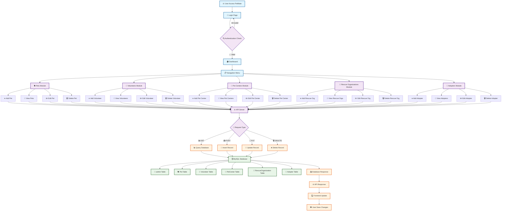

# PetMate System - Complete Explanation

## What is PetMate?

PetMate is a **pet adoption management platform** that connects all the key players in the pet adoption ecosystem. Think of it as a digital hub where rescue organizations, pet centers, volunteers, and potential adopters can all interact and manage their information efficiently.

### The Problem PetMate Solves

Before PetMate, pet adoption was likely a chaotic process with:
- Paper-based records scattered across different organizations
- No centralized database of available pets
- Difficult coordination between rescue organizations and pet centers
- Manual tracking of volunteers and adopters
- Inefficient communication between stakeholders

### How PetMate Works

**1. User Authentication**
- Administrators log in through a secure login page
- The system validates credentials against the database
- Upon successful login, users access the main dashboard

**2. Centralized Dashboard**
- A clean navigation interface with five main modules
- Each module handles a specific aspect of pet adoption
- Real-time data management with instant updates

**3. Five Core Modules**

**🐕 Pets Module**
- Add new pets available for adoption
- Track pet details: name, age, breed, species, size, condition
- Edit pet information as needed
- Remove pets when they're adopted

**👥 Volunteers Module**
- Register new volunteers with contact information
- Manage volunteer details: name, phone, email, city, state
- Update volunteer information
- Remove volunteers when they're no longer active

**🏢 Pet Centers Module**
- Manage pet center information and locations
- Track center details: name, city, state, email, phone, occupancy
- Monitor current occupancy levels
- Add new pet centers to the network

**🏥 Rescue Organizations Module**
- Register rescue organizations
- Store organization details: name, email, location, phone
- Manage multiple rescue organizations
- Update organization information

**👤 Adopters Module**
- Register potential pet adopters
- Store adopter information: name, email, phone, address
- Track adopter preferences and history
- Manage adopter database

## Technical Architecture Deep Dive

### Frontend (React.js)
The user interface is built with React, providing:
- **Component-based architecture**: Each module is a separate component
- **State management**: Uses React hooks for local state
- **Routing**: React Router handles navigation between pages
- **HTTP communication**: Axios library for API calls
- **Responsive design**: CSS styling for different screen sizes

### Backend (Node.js + Express)
The server handles all business logic:
- **RESTful API**: Standard HTTP methods (GET, POST, PUT, DELETE)
- **Database operations**: MySQL queries for data persistence
- **Authentication**: User login validation
- **Error handling**: Comprehensive error management
- **CORS support**: Enables cross-origin requests

### Database (MySQL)
Stores all system data in structured tables:
- **admin**: User credentials for system access
- **Pet**: Complete pet information and status
- **Volunteer**: Volunteer details and contact information
- **PetCenter**: Pet center locations and capacity
- **RescueOrganization**: Organization details and contact info
- **Adopter**: Potential adopter information and preferences

## Data Flow Process

### 1. User Login Process
```
User enters credentials → Frontend sends to backend → Backend queries database → 
Database returns user data → Backend validates → Frontend receives response → 
User sees dashboard or error message
```

### 2. Data Management Process
```
User selects module → Frontend loads existing data → User performs action (add/edit/delete) → 
Frontend sends API request → Backend processes request → Backend updates database → 
Database confirms change → Backend sends response → Frontend updates display
```

### 3. Real-time Updates
```
Any change made → Immediately reflected in database → All users see updated information → 
No need to refresh page → Consistent data across all sessions
```

## Business Benefits

### For Rescue Organizations
- **Centralized pet database**: All available pets in one place
- **Efficient coordination**: Easy communication with pet centers
- **Better tracking**: Monitor pet status and adoption progress
- **Reduced paperwork**: Digital records instead of paper files

### For Pet Centers
- **Occupancy management**: Track available space and capacity
- **Pet coordination**: Easy transfer of pets between centers
- **Volunteer coordination**: Connect with available volunteers
- **Adoption facilitation**: Streamlined adoption process

### For Volunteers
- **Clear communication**: Easy contact with organizations
- **Task coordination**: Know where help is needed
- **Impact tracking**: See how their work helps pets
- **Flexible involvement**: Choose when and where to help

### For Adopters
- **Pet discovery**: Browse available pets easily
- **Information access**: Get detailed pet information
- **Process transparency**: Understand adoption steps
- **Better matching**: Find pets that fit their lifestyle

## System Strengths

### ✅ What Works Well
1. **Complete CRUD Operations**: All entities can be created, read, updated, and deleted
2. **Real-time Updates**: Changes are immediately reflected across the system
3. **User-friendly Interface**: Clean, intuitive navigation
4. **Scalable Architecture**: Can handle multiple users and large datasets
5. **RESTful Design**: Standard API patterns for easy integration
6. **Database Integrity**: Proper data relationships and constraints

### 🔧 Areas for Enhancement
1. **Security**: Password hashing and environment variables needed
2. **Performance**: Database indexing and caching could improve speed
3. **User Experience**: Better error messages and loading states
4. **Mobile Responsiveness**: Optimize for mobile devices
5. **Advanced Features**: Search, filtering, and reporting capabilities

## Complete System Flowchart



## Key Takeaways

### 🎯 **Core Purpose**
PetMate transforms the chaotic world of pet adoption into a streamlined, digital process that benefits everyone involved.

### 🔧 **Technical Excellence**
The system demonstrates solid software engineering principles with clean architecture, proper separation of concerns, and scalable design.

### 🚀 **Business Impact**
By digitizing and centralizing pet adoption processes, PetMate significantly improves efficiency, reduces errors, and helps more pets find loving homes.

### 🔮 **Future Potential**
With the current foundation, PetMate can easily expand to include features like:
- Pet-adopter matching algorithms
- Adoption tracking and analytics
- Mobile applications
- Integration with social media
- Advanced reporting and insights

PetMate represents a successful implementation of a real-world problem solution, combining technical expertise with practical business needs to create a valuable tool for the pet adoption community.
